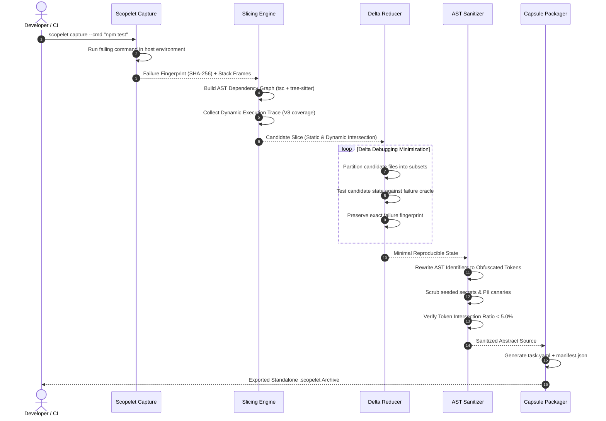
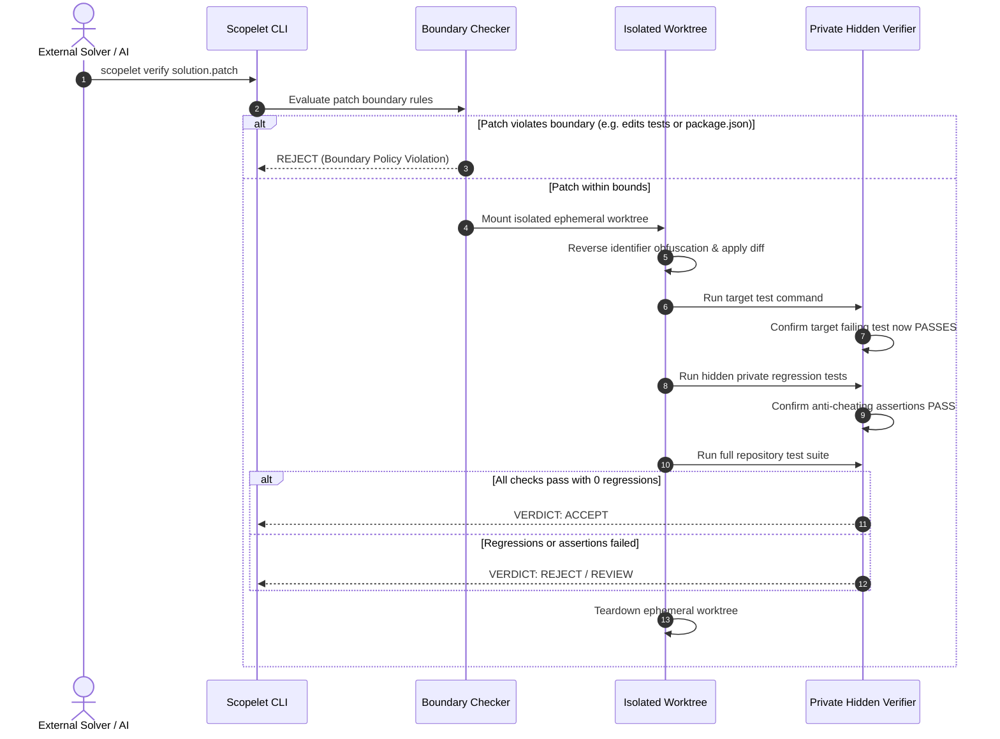

# Scopelet

> **AI proposes. Deterministic execution verifies.**

Scopelet captures production and CI test bugs, deterministically reduces repositories to minimal self-contained capsules without leaking private source code or credentials, and verifies returned patches inside the original private test suite.

---

## Key Capabilities

- **Deterministic Failure Fingerprinting**: Captures exact execution exit codes, normalized stdout/stderr and stack frames into a canonical SHA-256 fingerprint.
- **Static & Dynamic Slicing**: Merges tree-sitter AST dependency graphs, `tsc --traceResolution` module maps, V8 execution coverage traces and protected stack frames.
- **Delta-Debugging LOC Minimization**: Systematically culls non-essential files and statements while verifying preservation of the target failure fingerprint.
- **Mathematical Privacy Guarantees**: Renames AST symbols, redacts sensitive secrets across 7 categories (API keys, JWTs, emails, DB URLs, customer names, base64 strings and PII), and mathematically enforces under 5% token intersection overlap.
- **Isolated Execution Sandboxing**: Packages standalone reproducible `.scopelet` capsule archives runnable with Docker resource constraints (0 network access, read-only root, 512MB RAM cap).
- **Private Hidden Oracle Verification**: Evaluates external candidate patches against hidden regression tests, full suites and strict diff boundary policies (rejecting malicious test skips and out-of-scope edits).
- **Dual-Surface Interface**: Fully featured CLI command surface plus a real-time FastAPI REST service and web observatory dashboard.

---

## System Architecture

Scopelet separates repository reduction from patch verification through two deterministic loops:

```
+-----------------------------------------------------------------------------------+
|                           PRIVATE HOST WORKSPACE                                  |
|                                                                                   |
|  [Failing Test] ---> [Failure Capture] ---> [Static AST + Dynamic Trace Slicing]  |
|                                                                |                  |
|                                                                v                  |
|  [Sanitized Capsule] <--- [AST Sanitizer] <--- [Delta Debugging LOC Reducer]      |
+----------------------------|------------------------------------------------------+
                             |
                             v  (Public / Untrusted Sandbox Boundary)
+-----------------------------------------------------------------------------------+
|                        EXTERNAL SOLVER / CAPSULE SANDBOX                          |
|                                                                                   |
|  [.scopelet Archive] ---> [Isolated Container] ---> [AI Solver / Engineer Fix]    |
|                                                                |                  |
|                                                                v                  |
|                                                       [Candidate Patch Diff]      |
+----------------------------------------------------------------|------------------+
                             |
                             v  (Private Verification Boundary)
+-----------------------------------------------------------------------------------+
|                        PRIVATE HIDDEN VERIFIER ORACLE                             |
|                                                                                   |
|  [Patch Boundary Policy] -> [Git Worktree Apply] -> [Hidden Regression Tests]     |
|                                                                |                  |
|                                                                v                  |
|                                                    [VERDICT: ACCEPT / REJECT]     |
+-----------------------------------------------------------------------------------+
```

### Deterministic Reduction Sequence



### Isolated Verification Sequence



---

## Quickstart

### 1. Installation

```bash
# Clone the repository
git clone https://github.com/Ritinpaul/Scopelet.git
cd Scopelet

# Install Python package and development dependencies
pip install -e .

# Install Web Dashboard dependencies
cd apps/web
npm install
cd ../..
```

### 2. Run All Test Suites

```bash
# Unit, Integration and Adversarial Test Suites (225+ tests)
pytest tests/unit tests/integration tests/adversarial -v

# Full End-to-End Multi-Repo Pipeline Tests (3/3 fixtures)
pytest tests/end_to_end/ -v
```

### 3. Launch FastAPI Server & Web Dashboard

```bash
# Terminal 1: Launch FastAPI REST backend (port 8000)
uvicorn apps.api.app:app --host 0.0.0.0 --port 8000 --reload

# Terminal 2: Launch Vite React Observatory Dashboard (port 3000)
cd apps/web
npm run dev
```

Navigate to `http://localhost:3000` to inspect sessions, candidate graphs, canary scrubbing reports and test oracle verdicts.

---

## CLI Usage Manual

Scopelet provides an end-to-end command line interface:

### `scopelet init`
Initializes a `.scopelet/config.yaml` configuration in the target project.
```bash
scopelet init \
  --project "Billing Microservice" \
  --lang "typescript" \
  --test-cmd "npm test"
```

### `scopelet capture`
Executes the failing test suite, normalizes execution output and generates the deterministic SHA-256 failure fingerprint.
```bash
scopelet capture --cmd "npm test -- invoice"
```

### `scopelet analyze`
Generates static dependency graphs and collects dynamic V8 execution coverage to compute the initial candidate slice.
```bash
scopelet analyze
```

### `scopelet reduce`
Applies delta debugging minimization to eliminate irrelevant source files while guaranteeing that the failure fingerprint is strictly preserved.
```bash
scopelet reduce --max-evals 30
```

### `scopelet sanitize`
Rewrites AST identifiers, obfuscates proprietary symbols and scrubs credentials across 7 sensitive categories.
```bash
scopelet sanitize
```

### `scopelet review`
Opens an interactive privacy approval review of obfuscated symbol tables and secret scanner audit results before packaging.
```bash
scopelet review
```

### `scopelet export`
Packs the sanitized minimal reproduction workspace into a standalone `.scopelet` archive containing `task.yaml` and `manifest.json`.
```bash
scopelet export ./capsules/invoice-timezone.scopelet
```

### `scopelet capsule`
Manages and executes standalone capsules in isolated containers without access to the host repository.
```bash
# Run the capsule inside an isolated container
scopelet capsule run ./capsules/invoice-timezone.scopelet

# Unpack the capsule into a solver workspace
scopelet capsule open ./capsules/invoice-timezone.scopelet --dest ./solver-ws

# Inspect capsule metadata and integrity hash
scopelet capsule status ./capsules/invoice-timezone.scopelet
```

### `scopelet submit`
Runs local tests inside the solver workspace and exports `solution.patch` with a verification manifest.
```bash
scopelet submit
```

### `scopelet verify`
Evaluates an external patch against private hidden regression tests inside an isolated ephemeral worktree.
```bash
scopelet verify ./solution.patch
```

### `scopelet create` (Unified Combo)
Convenience command that runs the entire lifecycle (capture -> analyze -> reduce -> sanitize -> review -> export) in a single automated step.
```bash
scopelet create --cmd "npm test -- invoice" --issue "Invoice timezone offset defect"
```

---

## REST API Specification

The FastAPI service exposes 9 REST endpoints managing sessions and pipeline phases:

### Base URL: `http://localhost:8000`

### Endpoints Overview

| Method | Path | Description |
|---|---|---|
| `POST` | `/sessions` | Create a new debugging session |
| `POST` | `/sessions/{id}/capture` | Trigger failure capture and fingerprint extraction |
| `POST` | `/sessions/{id}/analyze` | Run static graph and dynamic coverage slice analysis |
| `POST` | `/sessions/{id}/reduce` | Execute delta debugging LOC reduction |
| `POST` | `/sessions/{id}/sanitize` | Execute AST identifier rewriting and canary scrubbing |
| `POST` | `/sessions/{id}/export` | Package standalone `.scopelet` capsule archive |
| `POST` | `/sessions/{id}/verify` | Run private hidden oracle verification on a patch |
| `GET` | `/sessions/{id}` | Retrieve session status and metadata |
| `GET` | `/sessions/{id}/report` | Retrieve comprehensive privacy and reduction audit report |

---

### Request & Response Examples

#### 1. Create Session
**`POST /sessions`**
```json
// Request
{
  "workspace_dir": "fixtures/timezone-bug",
  "test_command": "npm test"
}

// Response (200 OK)
{
  "id": "c9e2b10a",
  "status": "initialized",
  "workspace_dir": "fixtures/timezone-bug",
  "test_command": "npm test",
  "created_at": "2026-10-19T02:00:00Z",
  "updated_at": "2026-10-19T02:00:00Z"
}
```

#### 2. Capture Failure
**`POST /sessions/c9e2b10a/capture`**
```json
// Response (200 OK)
{
  "session_id": "c9e2b10a",
  "status": "captured",
  "fingerprint": "a87f1c90d3e2154bb39f098231fa6b87201c90a187b46d92ec1734919cb2ef81",
  "exit_code": 1,
  "stack_frames": [
    "src/date/timezone.ts:16:3",
    "src/billing/invoice.service.ts:42:15",
    "tests/invoice.timezone.test.ts:28:10"
  ]
}
```

#### 3. Compute Slice
**`POST /sessions/c9e2b10a/analyze`**
```json
// Response (200 OK)
{
  "session_id": "c9e2b10a",
  "status": "analyzed",
  "static_candidate_count": 7,
  "dynamic_trace_count": 3,
  "combined_slice_count": 3
}
```

#### 4. Delta Debugging Reduction
**`POST /sessions/c9e2b10a/reduce`**
```json
// Request
{
  "max_evaluations": 30
}

// Response (200 OK)
{
  "session_id": "c9e2b10a",
  "status": "reduced",
  "initial_files": 28,
  "reduced_files": 3,
  "initial_loc": 1420,
  "reduced_loc": 168,
  "reduction_percentage": 88.17,
  "evaluations": 14
}
```

#### 5. Verify Patch
**`POST /sessions/c9e2b10a/verify`**
```json
// Request
{
  "solution_patch": "--- a/src/date/timezone.ts\n+++ b/src/date/timezone.ts\n@@ -15,7 +15,11 @@\n export function formatToTimezoneDate(date: Date, timezone: string = DEFAULT_TIMEZONE): string {\n-  const year = date.getUTCFullYear();\n+  const formatter = new Intl.DateTimeFormat('en-CA', {\n+    timeZone: timezone,\n+    year: 'numeric',\n+    month: '2-digit',\n+    day: '2-digit',\n+  });\n+  return formatter.format(date);\n }\n"
}

// Response (200 OK)
{
  "session_id": "c9e2b10a",
  "verdict": "ACCEPT",
  "patch_hash": "62e91a0b3c812d4fa920",
  "rejection_reasons": [],
  "target_test_passed": true,
  "hidden_regression_passed": true,
  "full_suite_passed": true,
  "duration_ms": 782
}
```

---

## Test Fixtures Reference

Scopelet is verified against 3 production-grade sample fixtures with authentic hidden regressions:

| Fixture | Bug Category | Target Failing Test | Hidden Regression Oracle | Verified Solution |
|---|---|---|---|---|
| `fixtures/timezone-bug` | Date formatting ignores timezone offset | `npm run test:invoice` | `npm run test:hidden` (DST transitions and month boundaries) | Rewrites date formatting using `Intl.DateTimeFormat` |
| `fixtures/rounding-bug` | Floating point cent truncation | `npm run test:rounding` | `npm run test:hidden` (Fractional cent half-up rounding) | Uses epsilon half-up formula `Math.round((amt + 1e-9) * 100) / 100` |
| `fixtures/cache-bug` | Stale cache read on profile update | `npm run test:cache` | `npm run test:hidden` (Sequential field invalidations) | Adds explicit cache key eviction `await this.cache.delete(key)` |

---

## Security & Privacy Assurance

1. **Anti-Cheating Test Oracle**: Patch submissions attempting to skip assertions via `test.skip`, hardcode specific return values, delete assertions or bump dependencies are automatically rejected.
2. **Canary Leakage Guarantee**: 500+ realistic canaries across 7 data categories are injected during adversarial testing to mathematically prove zero token leakage in generated capsules.
3. **Container Isolation Configuration**:
   ```python
   DOCKER_SECURITY_CONFIG = {
       "network_mode": "none",
       "mem_limit": "512m",
       "nano_cpus": 500_000_000,   # 0.5 Cores
       "pids_limit": 256,
       "read_only": True,
       "tmpfs": {"/tmp": "", "/home/node/.npm": ""},
       "user": "node",             # Non-root user
       "security_opt": ["no-new-privileges"],
       "cap_drop": ["ALL"]
   }
   ```

---

## License

Apache-2.0
